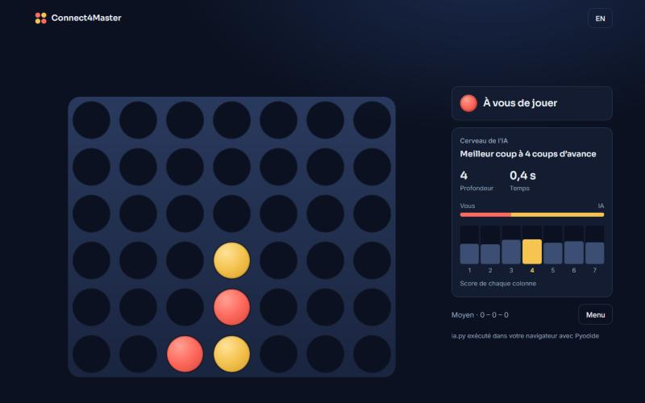

# Connect4Master

Puissance 4 contre une IA minimax écrite en Python, qui tourne directement dans le navigateur et montre son raisonnement en direct.

*[English version below](#english)*



## Fonctionnalités

- **IA Python sans serveur :** `ia.py` s'exécute dans le navigateur grâce à [Pyodide](https://pyodide.org), dans un Web Worker pour que l'interface reste fluide.
- **Cerveau de l'IA :** la profondeur atteinte, le score de chaque colonne et l'avantage estimé s'affichent pendant qu'elle réfléchit.
- **Trois niveaux :** 2 coups d'avance, 4 coups d'avance, ou recherche limitée à 4 secondes.
- **Plateau configurable :** de 5 à 10 lignes et colonnes.
- **Confort :** animations, version mobile, français et anglais, bilan sauvegardé, jeu au clavier (touches `1` à `9`, flèches, `Échap`).

## Comment fonctionne l'IA

`ia.py` combine plusieurs techniques :

1. **Tactique immédiate :** elle joue un coup gagnant ou bloque une menace directe.
2. **Minimax avec élagage alpha-bêta :** les colonnes centrales sont explorées en premier pour élaguer davantage.
3. **Approfondissement itératif :** elle cherche à profondeur 1, puis 2, puis 3, et garde le dernier résultat terminé dans le temps imparti. Elle s'arrête dès que l'issue de la partie est certaine.
4. **Évaluation heuristique :** chaque fenêtre de quatre cases est notée selon les alignements possibles, avec un bonus pour la colonne centrale.

## Architecture

| Élément | Rôle |
| --- | --- |
| `ia.py` | Moteur de l'IA, seule source Python, chargé tel quel par le navigateur |
| `src/engine.worker.ts` | Charge Pyodide et NumPy, puis appelle `IA_Decision` |
| `src/engine.ts` | Échanges entre l'interface et le worker |
| `src/game.ts` | Règles côté interface, pour un coup du joueur instantané |
| `src/components/` | Écrans, plateau et panneau d'analyse |

Interface réalisée avec React, TypeScript et Vite. Le site est statique : aucun serveur ne fait tourner Python. Pyodide et NumPy sont téléchargés depuis jsDelivr à la première visite, puis restent en cache.

## Lancer le projet

```bash
npm install
npm run dev
```

## Tests

```bash
npm test
```

```bash
pip install -r requirements.txt pytest
pytest tests
```

## Déployer sur Vercel

Importez le dépôt dans Vercel : le framework Vite est détecté automatiquement, sans configuration.

## Version d'origine

La première version en Pygame reste disponible avec le tag `v1-pygame`.

---

## English

Connect Four against a minimax AI written in Python. It runs right in the browser and shows its reasoning live.

### Features

- **Serverless Python AI:** `ia.py` runs in the browser through [Pyodide](https://pyodide.org), inside a Web Worker so the interface stays smooth.
- **AI brain:** search depth, the score of each column, and the estimated advantage update while it thinks.
- **Three levels:** 2 moves ahead, 4 moves ahead, or a search limited to 4 seconds.
- **Configurable board:** 5 to 10 rows and columns.
- **Polish:** animations, mobile layout, French and English, saved record, keyboard play (`1` to `9`, arrow keys, `Esc`).

### How the AI works

1. **Immediate tactics:** it plays a winning move or blocks a direct threat.
2. **Minimax with alpha-beta pruning:** center columns are explored first to prune more of the tree.
3. **Iterative deepening:** it searches depth 1, then 2, then 3, and keeps the last result finished in time. It stops as soon as the outcome is certain.
4. **Heuristic evaluation:** each four-cell window is scored by possible alignments, with a bonus for the center column.

### Run it

```bash
npm install
npm run dev
```

### Tests

```bash
npm test
```

```bash
pip install -r requirements.txt pytest
pytest tests
```

### Deploy to Vercel

Import the repository into Vercel. The Vite framework is detected automatically, with no configuration.

The original Pygame version is available at the `v1-pygame` tag.
